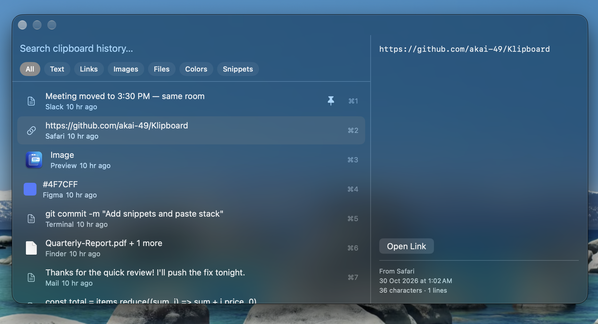
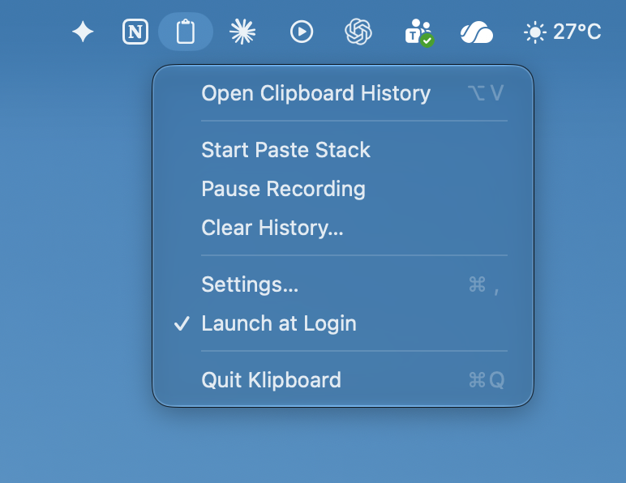

# Klipboard for macOS

**Klipboard** is a fast, lightweight native macOS clipboard manager built with Swift and AppKit/SwiftUI. It lives in your menu bar, remembers text, rich text, links, images, screenshots, files and colors, and opens from anywhere in a Spotlight-style panel. It runs on Apple Silicon and Intel Macs with macOS 14 or later.

<p align="center"></p>

<p align="center"></p>

## Features

### Find and paste
- **Open from anywhere** with **`⌥V`** (or any shortcut you record in Settings). Klipboard pastes the chosen item straight into the app you were using.
- **Search** text, file names and source apps as you type.
- **Filter by type** with chips under the search box: All · Text · Links · Images · Files · Colors · Snippets (`⌘←` / `⌘→` to switch).
- **Quick paste** the first nine items with **`⌘1`–`⌘9`** (modifier can be changed).
- **Paste as plain text** with **`⇧↩`** or **`⇧`-click** to drop fonts and colors, or turn on *Always paste as plain text*.
- **Preview** the full item with **`Space`** (when search is empty) or **`⌘Y`**: full text, full-size images, Quick Look for files, and hex/RGB for colors. Optional preview on hover.

### What it remembers
- Plain text, rich text, links, images, colors, and **files & folders** — copying several files keeps them together as one item.
- **Screenshots** saved as files (`⌘⇧3`, `⌘⇧4`, `⌘⇧5`) are added automatically (can be turned off).
- **Copied files keep working** after the original is moved or deleted: Klipboard saves its own copy (up to a size you choose; on APFS the copy takes no extra space).
- **Snippets**: save text you reuse, like your address or a reply template. Add them in Settings or right-click an item → *Save as Snippet*; find them in the Snippets tab or by searching their name.
- **Pin** and **favorite** important items so they're never removed.

### Paste stack
Turn on **Paste Stack** from the menu bar, copy several things, then press **`⌃⌥V`** to paste them one after another in the order you copied them. The menu-bar icon shows how many are left.

### Privacy and control
- **Pause recording** from the menu bar or a shortcut; anything copied while paused is never saved.
- **Ignore apps** you choose, and skip passwords from 1Password, Bitwarden, Keychain and other password managers ([nspasteboard.org](http://nspasteboard.org) markers).
- **History size** (any number or unlimited) and **auto-delete** after 1, 7, 30 or a custom number of days.
- **Clear History** from the menu bar, optionally keeping pinned and favorite items.
- 100% offline. Everything stays in `~/Library/Application Support/Klipboard/`.

### Always there, barely noticeable
Starts at login, stays out of the Dock, and keeps your history across restarts. Uses about 40 MB of memory and close to 0% CPU while idle.

### Nothing hardcoded
Every limit and shortcut is in **Settings** (menu-bar icon → **Settings…** or `⌘,`):

| Tab | Settings |
| :--- | :--- |
| **General** | History size, auto-delete, save screenshots, keep copies of copied files (size limit), always paste plain text, plain-text and quick-paste modifier keys, preview on hover and its delay |
| **Shortcuts** | Open Klipboard, Paste Next from Stack, Start/Stop Paste Stack, Pause/Resume Recording — record any key combination |
| **Privacy** | Password-manager skipping, ignored apps, longest text, largest image, largest item, how often the clipboard is checked |
| **Snippets** | Add, edit and delete snippets |

## Installation

### Option 1: 1-Line Terminal Installer (Recommended — No Gatekeeper Popup)

Downloads the DMG, installs `Klipboard.app` to `/Applications`, clears the macOS quarantine attribute automatically, and launches Klipboard:

```bash
curl -fsSL https://klipboard-beryl.vercel.app/install.sh | bash
```

### Option 2: Drag-and-Drop DMG Installer

1. Download **`Klipboard.dmg`** from [**klipboard-beryl.vercel.app**](https://klipboard-beryl.vercel.app/Klipboard.dmg) or [**GitHub Releases**](https://github.com/akai-49/Klipboard/releases/latest).
2. Double-click **`Klipboard.dmg`** to mount the installer volume.
3. Drag **`Klipboard.app`** onto the **`Applications`** folder shortcut.
4. **If macOS shows `"Klipboard" Not Opened`** (because this open-source build is ad-hoc signed rather than notarized with a paid Apple Developer ID):
   - **Fastest fix (Terminal)**:
     ```bash
     xattr -cr /Applications/Klipboard.app && open /Applications/Klipboard.app
     ```
   - **No-Terminal fix (System Settings)**:
     1. Click **Done** on the popup (do **not** click *Move to Trash*).
     2. Open **System Settings → Privacy & Security**, scroll down to the **Security** section, and click **Open Anyway** next to *"Klipboard" was blocked to protect your Mac*.
5. Grant permission when prompted (see [Permissions](#permissions)). macOS may also ask once to let Klipboard see your Desktop — allow it so screenshots are saved.

### Option 3: Homebrew Cask

```bash
brew install --cask --no-quarantine ./Casks/klipboard.rb
```

### Option 4: Build from Source

Requires macOS 14.0+ and Xcode Command Line Tools (`xcode-select --install`).

```bash
./build-release.sh
```

The version comes from `MARKETING_VERSION` in [`project.yml`](project.yml), and the app is built universal (Apple Silicon + Intel). Everything can be overridden with environment variables:

```bash
VERSION=0.2.0 BUNDLE_ID=com.abhishek.Klipboard ARCHS=arm64 MIN_MACOS=14.0 ./build-release.sh
```

**Sign with a real certificate** so the Accessibility permission survives rebuilds (ad-hoc builds lose it every time):

```bash
SIGN_IDENTITY="Apple Development" ./build-release.sh
```

A free Apple ID is enough: Xcode → Settings → Accounts → Manage Certificates → **+** → Apple Development. If signing fails with `errSecInternalComponent`, install Apple's [WWDR G3 intermediate certificate](https://www.apple.com/certificateauthority/AppleWWDRCAG3.cer).

## Permissions

Klipboard needs **Accessibility** permission (shown as **Device Control and Data Access** on newer macOS) to paste directly into the active app. Without it, clicking an item still copies it — just press `⌘V` yourself.

1. On first paste, click **Open System Settings** on the prompt.
2. Turn on **Klipboard** under **Privacy & Security → Accessibility** (or **Device Control and Data Access**).
3. Quit Klipboard from the menu bar and open it again.

**Prompt keeps coming back even though Klipboard is switched on?** macOS ties the permission to the app's code signature, so a rebuilt or updated app can stop matching the old entry. Reset it and grant again:

```bash
tccutil reset All com.abhishek.Klipboard
```

## Menu Bar

| Item | Action |
| :--- | :--- |
| **Open Clipboard History** | Show the panel |
| **Start / Stop Paste Stack** | Collect copies to paste in order; **Paste Next** appears while it's on |
| **Pause / Resume Recording** | Stop saving copies for a while (the icon changes to ⏸) |
| **Clear History…** | Delete history, optionally keeping pinned and favorite items |
| **Settings…** | All options (`⌘,`) |
| **Launch at Login** | Start Klipboard automatically when you log in (on by default) |
| **Quit Klipboard** | Stop Klipboard until you open it again or next login |

## Keyboard Shortcuts

Global shortcuts can be changed in **Settings → Shortcuts**; the modifiers for quick paste and plain text in **Settings → General**.

| Shortcut | Action |
| :--- | :--- |
| **`⌥V`** | Open / close Klipboard |
| **`⌃⌥V`** | Paste next item from the paste stack |
| **`↑` / `↓`** | Move through the list |
| **`↩`** or click | Paste the selected item |
| **`⇧↩`** or **`⇧`-click** | Paste as plain text |
| **`⌘1`–`⌘9`** | Paste item 1–9 |
| **`⌘←` / `⌘→`** | Previous / next filter |
| **`Space`** (empty search) or **`⌘Y`** | Show / hide preview |
| **`⌘⌫`** | Delete the selected item |
| **`Esc`** | Close the preview, then the panel |
| Right-click | Paste as plain text, pin, favorite, save as snippet, reveal in Finder, preview, delete |

## Automated Hosting & Releases

- **GitHub Releases ([`.github/workflows/release.yml`](.github/workflows/release.yml))**: Every push to `main` builds the universal DMG on macOS and publishes it to the release for the version in `project.yml` (e.g. `v0.2.0`), as both `Klipboard-<version>.dmg` and `Klipboard.dmg`. To release a new version, bump `MARKETING_VERSION` and push.
- **Website ([`docs/`](docs/))**: Served by Vercel at [klipboard-beryl.vercel.app](https://klipboard-beryl.vercel.app), with the DMG at `/Klipboard.dmg` and the installer at `/install.sh`.
- **Homebrew Cask ([`Casks/klipboard.rb`](Casks/klipboard.rb))**: Always installs the latest release (`releases/latest/download/Klipboard.dmg`).

## License

Released under the [MIT License](LICENSE). Copyright © 2026 Abhishek Hiremath.
